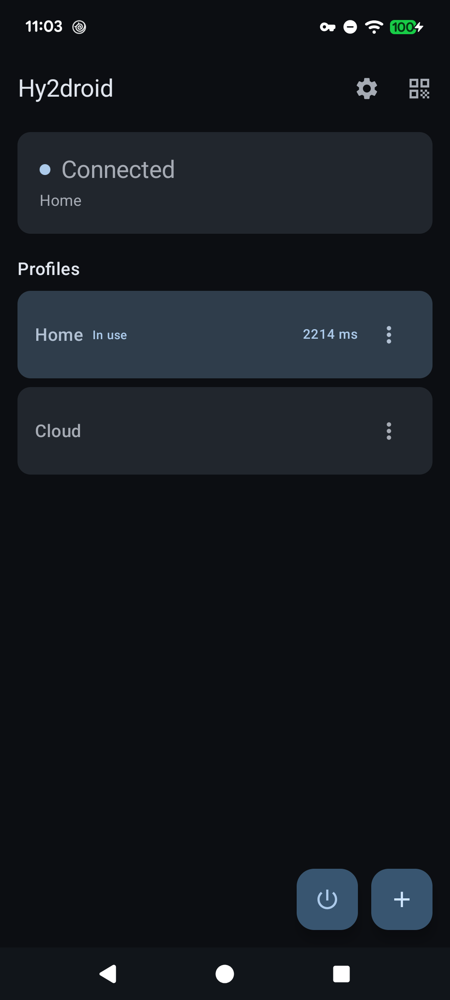
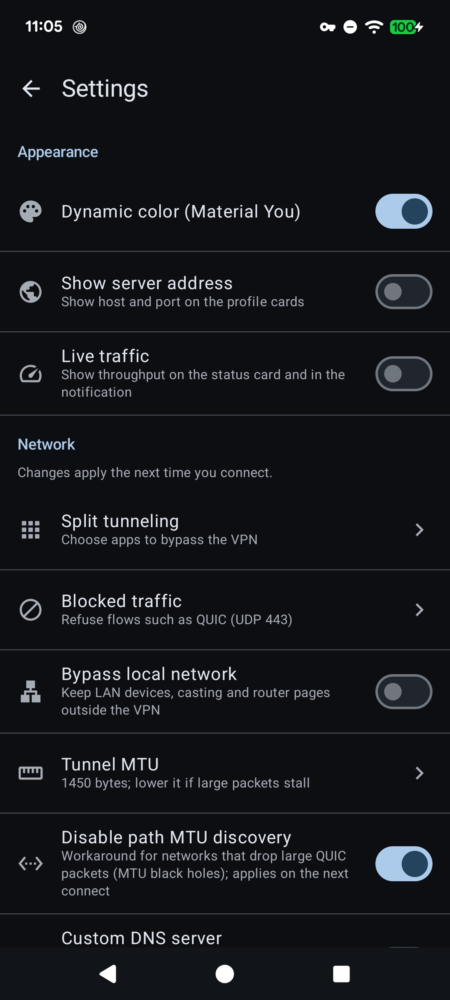

# Hy2droid — Hysteria 2 for Android

A native Android client for the [Hysteria 2](https://v2.hysteria.network/) proxy
protocol: a thin Kotlin/Jetpack Compose (Material 3) UI in front of an Android
`VpnService`, with the official Go core running as a child process and
[go-tun2socks](https://github.com/eycorsican/go-tun2socks) bridging the TUN
device to it.

Requires **Android 11 (API 30) or newer**. Ships `arm64-v8a`, `armeabi-v7a`,
`x86` and `x86_64` (per-ABI splits plus a universal APK).

<p align="center">
  
  
</p>

## Features

- Full-tunnel `VpnService` backed by Hysteria 2, dual-stack (IPv4 + IPv6)
- Multiple saved profiles; import by pasting a `hysteria2://` link or by
  scanning a QR code (fully offline scanner, no Play Services needed)
- Share a profile as a QR code
- Salamander obfuscation, custom SNI, optional "allow insecure certificate"
- Brutal congestion control via an upload/download bandwidth hint (0 = BBR)
- `fastOpen` is **off** by default; `lazy` is always on
- Custom DNS resolvers (primary/secondary, IPv4 or IPv6, validated). When
  disabled, no resolver is injected and DNS goes through the server egress
- Split tunnelling: pick apps that bypass the VPN
- Optional **LAN bypass** (Android 13+): local-network traffic — RFC1918,
  link-local, CGNAT and multicast (mDNS/SSDP) — stays outside the VPN, so NAS
  boxes, printers, router admin pages and casting keep working
- Quick Settings tile to connect/disconnect, kept in sync with the tunnel state
- Always-on VPN support (handles the system-initiated start)
- Live throughput in the UI; the notification is intentionally minimal (status
  plus a Disconnect action)
- Dynamic colour (Material You) toggle, custom DNS, split tunnelling in Settings
- Profiles and settings are included in Android Auto Backup

## Languages

The UI is translated into the six official languages of the United Nations, and
Android's per-app language picker (`Settings → Apps → Hy2droid → Language`) is
wired up through `res/xml/locales_config.xml`:

| Locale | Resource folder |
| --- | --- |
| English | `values/` (default) |
| Arabic (RTL) | `values-ar/` |
| Spanish | `values-es/` |
| French | `values-fr/` |
| Russian | `values-ru/` |
| Chinese (Simplified) | `values-zh-rCN/` |

All user-visible text lives in `strings.xml`; adding a language means copying
`values/strings.xml` into a new `values-<qualifier>/` folder and translating the
values (keep the `%1$s` / `%1$d` placeholders intact, escape apostrophes as `\'`).
`app_name` is deliberately not translated. The layouts only use direction-aware
padding/alignment, so RTL (Arabic) mirrors correctly.

## How it works

```
UI (Compose / Material 3)
  └─ MainViewModel ── renders config ──┐
                                       ▼
                     Hysteria2VpnService (VpnService)
                        ├─ VpnService.Builder → TUN fd
                        │    IPv4 10.0.88.88/16, IPv6 fc00::1/64, MTU 1500
                        ├─ exec libhysteria.so -c hysteria.yaml
                        │    → 127.0.0.1:1080 (SOCKS5) + :1081 (HTTP)
                        └─ libtun2socks.so (JNI): TUN fd → SOCKS5
```

The core runs as a child process exposing a local SOCKS5 listener; `tun2socks`
bridges the TUN device to it. The service monitors the child process and tears
the tunnel down if it exits.

`libtun2socks.so` binds its JNI symbols to the **exact** class
`us.leaf3stones.hy2droid.proxy.Hysteria2VpnService` and to the signatures of
`startTun2socks` / `stopTun2socks` / `getTun2socksStats`. Neither the class name
nor those signatures may change without rebuilding the `.so`, and ProGuard/R8 is
configured to keep them.

## Repository layout

| Path | Contents |
| --- | --- |
| `app/src/main/java/.../ui` | Compose UI (home, profile editor, settings, split tunnel, QR scanner) |
| `app/src/main/java/.../data` | `Profile`, `ProfileStore`, `SettingsStore`, `HysteriaConfigBuilder`, `HysteriaUri` |
| `app/src/main/java/.../proxy` | `Hysteria2VpnService`, `VpnTileService`, `TunnelStatus`, `Tun2socksConfig` |
| `app/src/main/jniLibs` | `libtun2socks.so` (committed); `libhysteria.so` is downloaded at build time |
| `core/core.properties` | Pinned Hysteria core version + per-ABI checksums |
| `scripts/core.sh` | Fetch / verify / upgrade the core |
| `.github/workflows` | `build.yml` (debug) and `release.yml` (signed release) |

## Building

Prerequisites: JDK 17 and an Android SDK with platform 34. The Hysteria core is
fetched automatically (see *Bundled core*), so a fresh clone builds with:

```bash
./gradlew assembleDebug        # app/build/outputs/apk/debug/
./gradlew testDebugUnitTest    # JVM unit tests
./gradlew assembleRelease      # signed APK when a keystore is present
```

## Bundled core

The Hysteria core binaries are **not committed to git**. They are downloaded at
build time from the upstream release (`hysteria-android-<arch>`), verified
against that release's `hashes.txt`, and installed into
`app/src/main/jniLibs/<abi>/libhysteria.so`. `core/core.properties` pins the
version plus the per-ABI SHA-256 checksums and is surfaced to the app as
`BuildConfig.CORE_VERSION` (logged by the service on every connect).

`scripts/core.sh` manages it:

| Command | Description |
| --- | --- |
| `scripts/core.sh fetch` | Install the pinned core (no-op when already present); Gradle runs this via the `fetchCore` task on `preBuild` |
| `scripts/core.sh latest` | Resolve the newest upstream release tag |
| `scripts/core.sh upgrade [tag\|latest]` | Install a specific (default: newest) core |
| `scripts/core.sh version` | Pinned version + whether the binaries match |
| `scripts/core.sh verify` | Verify the binaries against the manifest (run in CI) |
| `scripts/core.sh hashes` | Print the per-ABI checksums |

CI installs **the newest upstream release on every build** and prints the resolved
version in the run summary. Pin a build with the `core_tag` workflow input
(e.g. `app/v2.12.3`) or locally:

```bash
HY2_CORE_TAG=app/v2.12.3 ./gradlew assembleDebug   # one-off override
scripts/core.sh upgrade app/v2.12.3                # move the committed pin
```

ABI mapping: `arm64-v8a` → `arm64`, `armeabi-v7a` → `armv7`, `x86_64` → `amd64`,
`x86` → `386`. A core bump needs no app changes because the service only execs
the binary with `-c <config>`; if a release changes the YAML schema,
`HysteriaConfigBuilder` is the only app-side touch point.

## Continuous integration and releases

| Workflow | Trigger | Output |
| --- | --- | --- |
| `.github/workflows/build.yml` | push to `main`, or manual | debug APK as a workflow artifact |
| `.github/workflows/release.yml` | pushing a `v*` tag, or manual with a version | signed release APKs + a GitHub Release |

Both fetch the newest core, verify it, and build. The release workflow signs with
a keystore taken from repository secrets, verifies the signature with
`apksigner`, and publishes `app-universal-release.apk` plus the four ABI splits.

### Setting up signing

Add four repository secrets (Settings → Secrets and variables → Actions):

| Secret | Value |
| --- | --- |
| `ANDROID_KEYSTORE_BASE64` | keystore, base64-encoded: `base64 -w0 signing/production.jks` |
| `ANDROID_KEYSTORE_PASSWORD` | keystore password |
| `ANDROID_KEY_PASSWORD` | key password |
| `ANDROID_KEY_ALIAS` | key alias |

Create the keystore once and back it up — losing it means installed apps can
never be updated under the same package name:

```bash
keytool -genkeypair -v -keystore signing/production.jks -alias signing \
  -keyalg RSA -keysize 2048 -validity 10000
```

Then publish by pushing a tag (or from the Actions tab with a version input):

```bash
git tag v2.1.0 && git push origin v2.1.0     # versionName 2.1.0
```

`versionName` comes from the tag (or the `version_name` input) and `versionCode`
from the workflow run number, so every release is upgradeable. Without
`ANDROID_KEYSTORE_BASE64` the workflow still builds (validating R8/ProGuard
against the JNI bindings) but produces an unsigned APK, skips the signature
check and does not publish.

To sign locally, place the keystore at `signing/production.jks` (gitignored, or
point `HY2_KEYSTORE_FILE` at it) and export `HY2_KEYSTORE_PASSWORD`,
`HY2_KEY_PASSWORD`, `HY2_KEY_ALIAS`, then run `./gradlew assembleRelease`.

## Profile fields

- **Server** — domain or IP, plus a separate **port** field (default `443`)
- **Auth** — the Hysteria 2 password
- **SNI** — TLS server name; blank means "derive from the server host". Needed
  when the server is addressed by IP but the certificate is issued to a hostname
- **Obfuscation password** — Salamander password; blank disables obfs
- **Upload / Download Mbps** — your real line speeds to enable Brutal; both 0
  keeps BBR (see the
  [official docs](https://v2.hysteria.network/docs/advanced/Full-Server-Config/))
- **Allow insecure certificate** — skips TLS verification; keep it off unless
  you know what you are doing
- **QUIC fast open** — off by default; only enable it if you know your network
  tolerates QUIC 0-RTT

## Troubleshooting

- The core logs to logcat under the `hysteria` tag (lines containing a share URI
  or the obfs password are redacted).
- The service logs to the `Hysteria2VpnService` tag, including the bundled core
  version at every connect: `adb logcat -s Hysteria2VpnService | grep 'Hysteria core'`.
- If a newly released core breaks connectivity, pin the previous one via the
  `core_tag` input or `HY2_CORE_TAG` and open an issue.

## Credits

- [hysteria](https://github.com/apernet/hysteria) — protocol and reference
  implementation. [LICENSE](https://github.com/apernet/hysteria/blob/master/LICENSE.md)
- [go-tun2socks](https://github.com/eycorsican/go-tun2socks) — TUN ↔ SOCKS5
  bridge. [LICENSE](https://github.com/eycorsican/go-tun2socks/blob/master/LICENSE)

This application is provided for learning and personal use. Follow the laws of
your jurisdiction.
